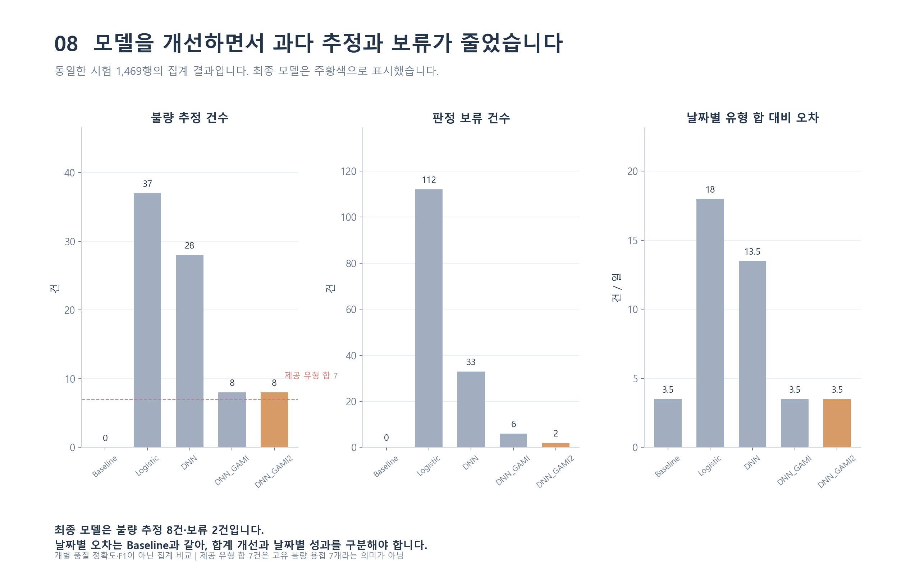
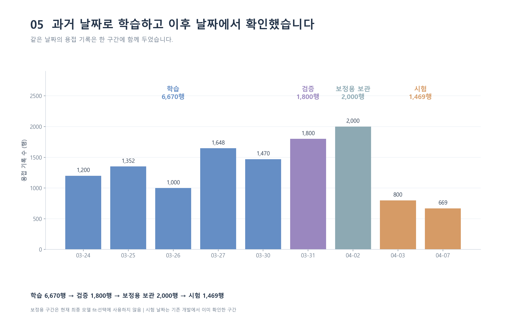
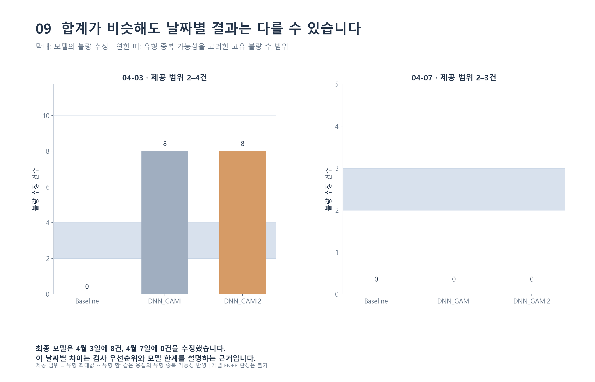
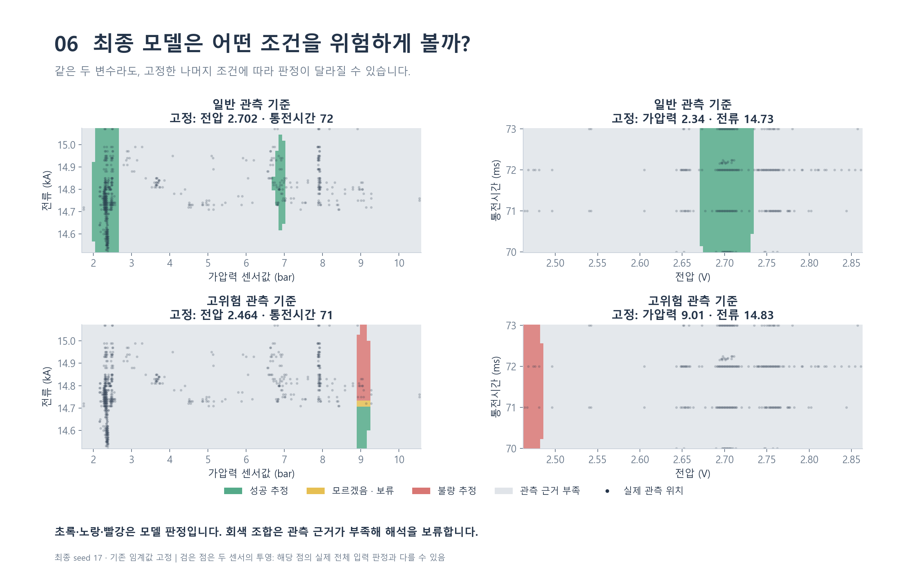
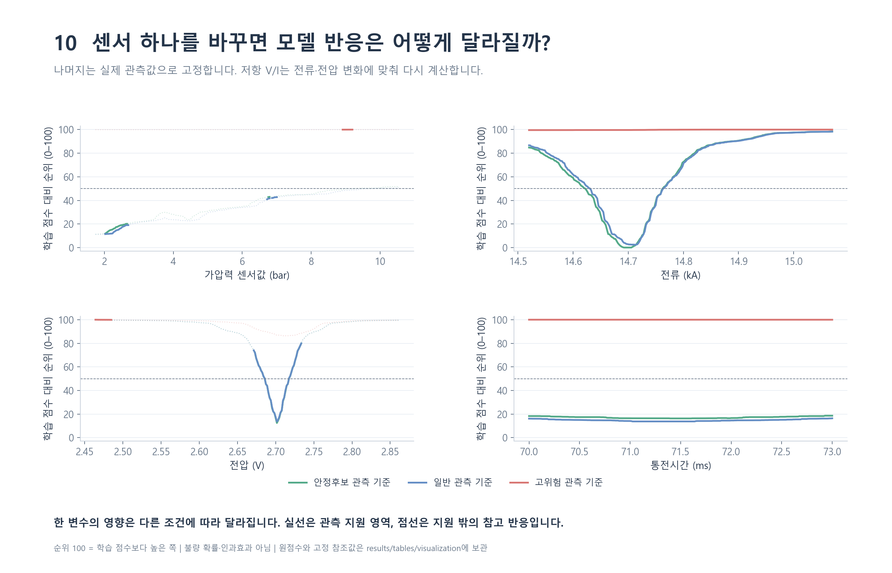
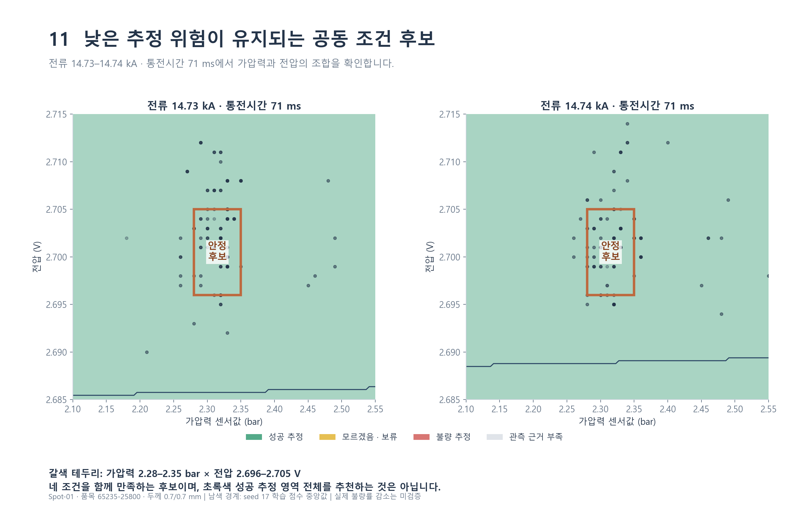
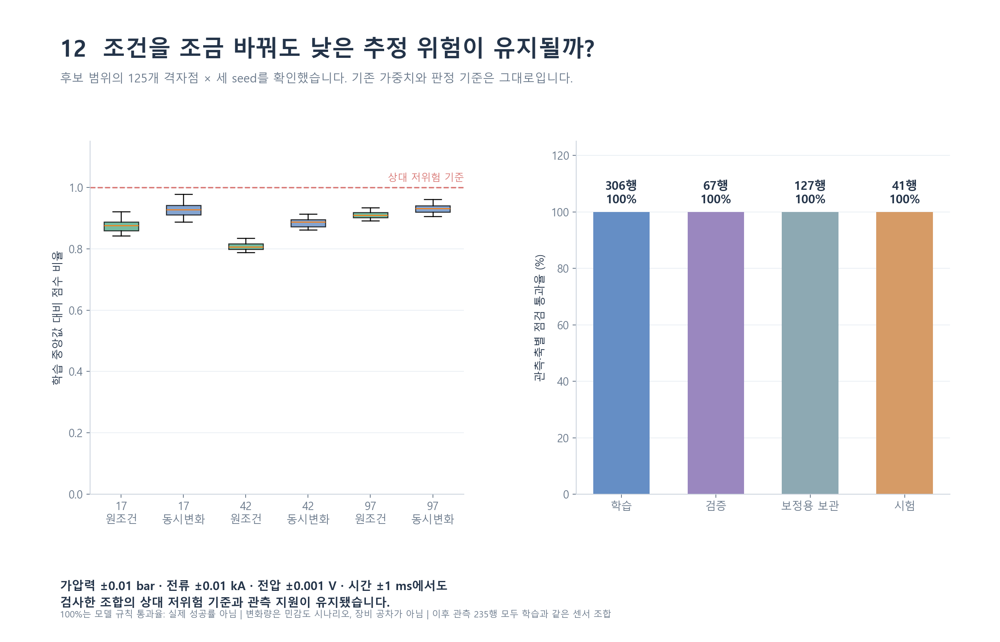

<div align="center">

# Welding Risk Estimation

### 저항 지표로 확장한 DNN+GAMI 기반 용접 위험 추정 및 공정조건 탐색

**Resistance-Indicator-Augmented DNN+GAMI for Welding Risk Estimation and Process Parameter Exploration**

제6회 K-인공지능 제조데이터 분석 경진대회 · **Episode 팀** · 2026

</div>

> **프로젝트 요약**  
> 개별 용접의 품질 정답이 없는 제조 센서 데이터에서 날짜별 불량 집계를 학습 제약으로 활용하고, **DNN+GAMI 혼합 모델에 저항 지표를 추가**해 용접 위험 점수를 추정하였다. 모델의 출력을 검사 우선순위와 저위험 공정조건 후보 탐색으로 연결하였다.

<p align="center">
  
</p>

## 1. Project Overview

저항용접 공정에서는 가압력, 전류, 전압, 통전시간에 따라 접합 조건이 달라진다. 그러나 본 프로젝트에 제공된 데이터는 **개별 용접의 합격·불합격 라벨 대신 날짜별 불량 유형의 집계값**만 포함하고 있었다. 이 때문에 일반적인 지도학습 분류기로 불량 여부를 직접 학습하기 어려웠다.

이를 해결하기 위해 날짜별 집계 정보를 학습에 반영하는 **DNN+GAMI** 모델을 구성하고, 전압과 전류의 비율로 계산한 **저항 지표**를 추가한 **Augmented DNN+GAMI**를 최종 모델로 선정하였다. 모델은 개별 기록의 위험 점수를 산출하고 이를 `성공 추정 / 불량 추정 / 판정 보류`로 구분한다.

**핵심 결과 (시험 데이터 1,469행)**

| 항목 | 결과 |
|---|---:|
| DNN 대비 불량 합계 오차 | **21건 → 1건** |
| DNN 대비 날짜별 MAE | **13.5건 → 3.5건** |
| 기존 DNN+GAMI 대비 판정 보류 | **6건 → 2건** |
| 최종 모델 판정 보류율 | **0.14%** |
| 검사 우선 확인 대상 | **불량 추정 8건 + 보류 2건** |
| 저위험 공정조건 후보 | **C1 (125개 격자 조합 점검)** |

> 여기서 *불량 합계 오차*와 *날짜별 MAE*는 **모델의 불량 추정 건수와 제공된 날짜별 불량 집계의 차이**다. 실제 개별 불량 라벨을 기준으로 계산한 분류 Accuracy·Recall이 아니다.

## 2. Dataset & Problem Definition

제공된 용접 데이터는 2020년 3월 24일부터 4월 7일까지 **9개 작업일, 11,939행**으로 구성된다. 두 접합 소재의 두께는 각각 0.7 mm로 일정하다.

| 입력 변수 | 단위 | 관측 범위 |
|---|---|---|
| 가압력 (Weld Force) | bar | 1.74–10.54 |
| 전류 (Weld Current) | kA | 14.52–15.07 |
| 전압 (Weld Voltage) | V | 2.464–2.861 |
| 통전시간 (Weld Time) | ms | 70–73 |

원본 센서값을 수치형으로 변환하고 날짜 형식을 통일하였다. 반복 관측은 제거하지 않았으며, 날짜 순서를 유지하도록 다음과 같이 분리하였다.

| 구간 | 날짜 | 용접 기록 |
|---|---|---:|
| Train | 03.24–03.30 | 6,670 |
| Validation | 03.31 | 1,800 |
| Calibration | 04.02 | 2,000 |
| Test | 04.03, 04.07 | 1,469 |
| **Total** | **9개 작업일** | **11,939** |



### 날짜별 집계를 이용한 학습

날짜별로 제공된 불량 유형 건수에는 중복 가능성과 일부 결측이 있었다. 개별 용접에 임의의 정답 라벨을 부여하는 대신, 유형별 건수가 모두 제공된 날짜에 대해 다음 참고 구간을 구성하였다.

- **하한:** 불량 유형별 집계 중 최대 건수
- **상한:** 불량 유형별 집계의 합계
- **학습 목표:** 같은 날짜에 속한 용접 기록의 위험 점수 합이 참고 구간에 들어오도록 학습

이러한 집계 기반 학습을 통해 개별 센서 기록을 입력받는 모델을 구성하였다.

## 3. Model Architecture

### 3.1 DNN + GAMI

두 모델을 병렬로 구성하여 서로 다른 유형의 관계를 학습하도록 설계하였다.

- **GAMI-Net:** 각 센서의 개별 효과(Main Effect)와 두 센서 간 상호작용(Pairwise Interaction) 학습
- **DNN:** 전체 센서 입력의 복합적인 비선형 관계 학습
- **결합 출력:** GAMI 성분과 DNN 출력을 결합하고 Sigmoid를 적용해 위험 점수 산출

학습은 변수별 효과와 상호작용을 먼저 학습한 뒤, DNN을 포함한 전체 구조를 공동 조정하는 순서로 진행하였다.

### 3.2 Resistance-Indicator-Augmented DNN+GAMI

기존 4개 센서에 전압과 전류에서 계산한 저항 지표를 추가하였다.

\[
R_{\mathrm{m\Omega}} = \frac{V_{\mathrm{V}}}{I_{\mathrm{kA}}}
\]

입력 5개는 학습 구간 통계로 표준화한 뒤 GAMI와 DNN에 전달한다. DNN 분기의 구조는 `5 → 32 → 16 → 1`이며, 최종 코드에서는 이 모델을 **`DNN_GAMI2`**로 표기한다. 저장소의 대표 최종 체크포인트는 **seed 17**이다.

```text
Pressure / Current / Voltage / Weld Time
                    │
           Resistance = V / I
                    │
      Five-input standardization
                    │
          ┌─────────┴─────────┐
          ▼                   ▼
       GAMI-Net             DNN
    Main + Pairwise       5-32-16-1
          │                   │
          └─────────┬─────────┘
                    ▼
          Combined Risk Logit
                    ▼
                 Sigmoid
                    ▼
            Risk Score (0–1)
                    ▼
     Success / Defect / Abstain
```

최종 모델의 판정 기준은 다음과 같다.

| 위험 점수 | 판정 |
|---|---|
| `score < 0.08192` | 성공 추정 |
| `0.08192 ≤ score < 0.09102` | 판정 보류 |
| `score ≥ 0.09102` | 불량 추정 |

## 4. Experimental Results

Baseline을 포함한 다섯 모델을 **동일한 Test 1,469행**에서 비교하였다. Logistic 및 DNN은 센서 분포에서 생성한 임시 라벨을 사용하는 비교모델이며, DNN+GAMI 계열은 날짜별 불량 집계 정보를 학습에 반영한다.

| Model | 불량 합계 오차 | 날짜별 MAE | 판정 보류 |
|---|---:|---:|---:|
| Baseline (모두 성공 추정) | 비교 기준 | — | 0건 |
| Logistic | 30건 | 18.0건 | — |
| DNN | 21건 | 13.5건 | — |
| DNN+GAMI | **1건** | **3.5건** | 6건 |
| **Augmented DNN+GAMI (Final)** | **1건** | **3.5건** | **2건** |

저항 지표를 추가한 최종 모델은 기존 DNN+GAMI와 집계 오차를 동일하게 유지하면서 판정 보류 건수를 **6건에서 2건**으로 줄였다.

### 날짜별 시험 결과

| 시험 날짜 | 제공 불량 유형 합계 | 불량 추정 | 추정−집계 | 판정 보류 |
|---|---:|---:|---:|---:|
| 04.03 | 4 | 8 | +4 | 2 |
| 04.07 | 3 | 0 | −3 | 0 |

4월 3일의 불량 추정 8건은 **높은 가압력(9.01–9.27 bar)**과 **낮은 전압(2.464–2.474 V)**이 함께 관측된 기록에 집중되었다. 보류 2건 역시 낮은 전압 조건에서 발생하였다.



### 판정 영역과 센서 영향

전류와 통전시간을 일정하게 고정한 상태에서 입력 조건을 변화시켜 모델별 위험 판정 영역을 비교하였다. 기존 DNN+GAMI는 가압력·전압의 결합 관계에서, Augmented DNN+GAMI는 **저항·가압력의 결합 관계**에서 판정 영역을 확인하였다.



일반 관측 조건에서는 전류 약 14.7 kA와 전압 약 2.70 V 주변에서 상대적으로 낮은 위험 점수가 나타났다. 고위험 조건에서는 전류 변화에 따른 위험 점수와 전압에 따른 판정 경계 변화를 확인하였다.



## 5. Process Parameter Exploration

모델 판정을 현장 의사결정과 연결하기 위해 두 가지 활용 방안을 구성하였다.

**검사 우선순위:** 불량 추정 기록을 우선 검사하고, 판정 보류 기록은 센서값 확인 및 추가 품질검사 대상으로 분류한다. Test 구간에서는 총 **10건(불량 추정 8건 + 보류 2건)**이 우선 확인 목록에 포함되었다.

**공정조건 탐색:** 최종 모델을 고정하고 학습 데이터에서 반복 관측된 저위험 조건을 탐색하였다. 세 개 seed의 점수 일관성, 관측 지원, 국소 민감도를 검토하여 공동 공정조건 후보 **C1**을 도출하였다.

| 변수 | C1 후보 범위 |
|---|---|
| 가압력 | **2.28–2.35 bar** |
| 전류 | **14.73–14.74 kA** |
| 전압 | **2.696–2.705 V** |
| 통전시간 | **71 ms** |

C1에 해당하는 학습 기록은 **306행, 5개 작업일**에 걸쳐 관측되었다. 범위 안의 **125개 격자 조합**에서 관측 지원과 국소 민감도 점검을 통과하였다. 네 변수는 각각 독립적인 권장값이 아니라 **함께 적용하는 하나의 후보 조합**이다.





C1은 모델과 기존 관측 기록에서 도출한 **검토용 공정조건 후보**이며, 현장 적용 전 설비 설정값과 센서값의 관계를 확인하고 시험운전·접합 품질검사를 수행하도록 설계하였다.

## 6. Repository Structure

이 저장소에는 재실행에 필요한 소스 코드, 대표 모델 가중치, 원본 Excel, README용 주요 시각화 자료만 남겼다. 전처리 CSV 및 분석 중간 산출물은 실행 시 다시 생성된다.

```text
Welding_Risk_Estimation/
├── data/
│   └── raw/                 # Provided welding sensor Excel
├── examples/
│   ├── four_sensor_weld.json
│   └── inference.py         # Sample inference
├── src/
│   ├── dnn_anomaly.py
│   ├── dnn_gami.py
│   ├── dnn_gami2.py         # Final model
│   ├── process_window/      # Process condition exploration
│   ├── tests/               # Unit tests
│   ├── cli.py               # Prediction and model comparison CLI
│   └── ...
├── results/
│   ├── figures/             # Selected EDA, model and process figures
│   └── models/              # Selected checkpoints and metadata
├── EDA.py
├── Baseline.py
├── train_Logistic.py
├── train_DNN.py
├── train_DNN_GAMI.py
├── train_DNN_GAMI2.py
└── requirements.txt
```

## 7. How to Run

Python **3.13** 환경에서 학습하였으며, 의존 패키지는 `requirements.txt`에 명시되어 있다. 아래 명령은 저장소 최상위 폴더에서 실행한다.

### 1) 설치

```bash
git clone https://github.com/raccoon297/Welding_Risk_Estimation.git
cd Welding_Risk_Estimation
python -m pip install -r requirements.txt
```

### 2) 원본 데이터 전처리

```bash
python EDA.py
```

날짜별 분할, 전처리 CSV 및 기초 분석 결과가 생성된다.

### 3) 최종 모델 예제 추론

```bash
python -m examples.inference
```

기본 예제에는 가압력, 전류, 전압, 통전시간 4개 값을 입력하며 **저항 지표는 내부에서 자동 계산**한다. 별도 CSV 저장이 필요하면 다음을 실행한다.

```bash
python -m src.cli predict --model DNN_GAMI2 --input examples/four_sensor_weld.json --output results/tables/predictions/example.csv
```

### 4) 다섯 모델 성능 비교

```bash
python -m src.cli compare
```

저장된 가중치를 불러와 Train/Validation/Calibration/Test 구간을 평가하고, Test의 모델별 불량 추정 건수와 집계 오차를 출력한다.

### 5) 선택 실행: 재학습 및 공정조건 탐색

```bash
# 기존 대표 체크포인트를 보존한 채 별도 경로에 재학습
python train_DNN_GAMI2.py --seed 17 --output results/models/retrained/DNN_GAMI2_seed17

# 전처리 후 공정조건 탐색 결과 생성
python src/process_window/analyze_process_window.py

# 단위 테스트
python -m unittest discover -s src/tests -v
```

학습 스크립트는 기존 최종 모델 가중치를 덮어쓰지 않으며, 추가로 생성되는 결과 파일은 재현 목적의 산출물이다.

## 8. My Contribution & Team

- **팀명:** Episode
- **프로젝트:** 제6회 K-인공지능 제조데이터 분석 경진대회 제출작 (2026.10)
- **팀장:** 윤동환
- **팀원:** 구도원, 허재영

**담당 업무:** DNN+GAMI 기반 위험 추정 모델 설계, 모델 학습·추론 및 평가 Python 코드 작성, 최종 결과보고서 작성. 데이터 전처리와 아이디어 검토, 발표자료 준비는 팀 단위로 역할을 분담하였다.

## 9. Evaluation Scope

제공 데이터에는 개별 용접별로 검증된 품질 정답이 없어 **날짜별 불량 집계와의 일치도**를 중심으로 평가하였다. 따라서 위험 점수를 실제 불량 확률로 해석하거나, 본 결과를 개별 불량 검출 정확도로 표현하지 않는다. 공정조건 후보 C1 역시 학습 데이터에서 도출한 조건으로 현장 시험운전 결과는 포함하지 않는다.

---

**Tech Stack:** `Python` · `PyTorch` · `NumPy` · `Pandas` · `scikit-learn` · `Matplotlib` · `GAMI-Net` · `Weak Supervision` · `Manufacturing Data`
